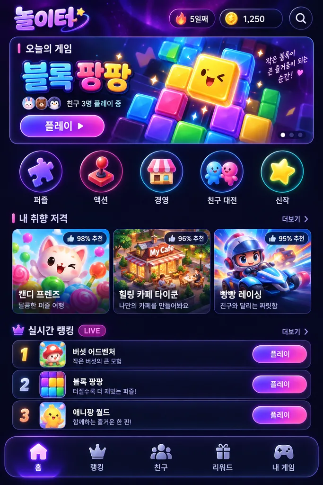
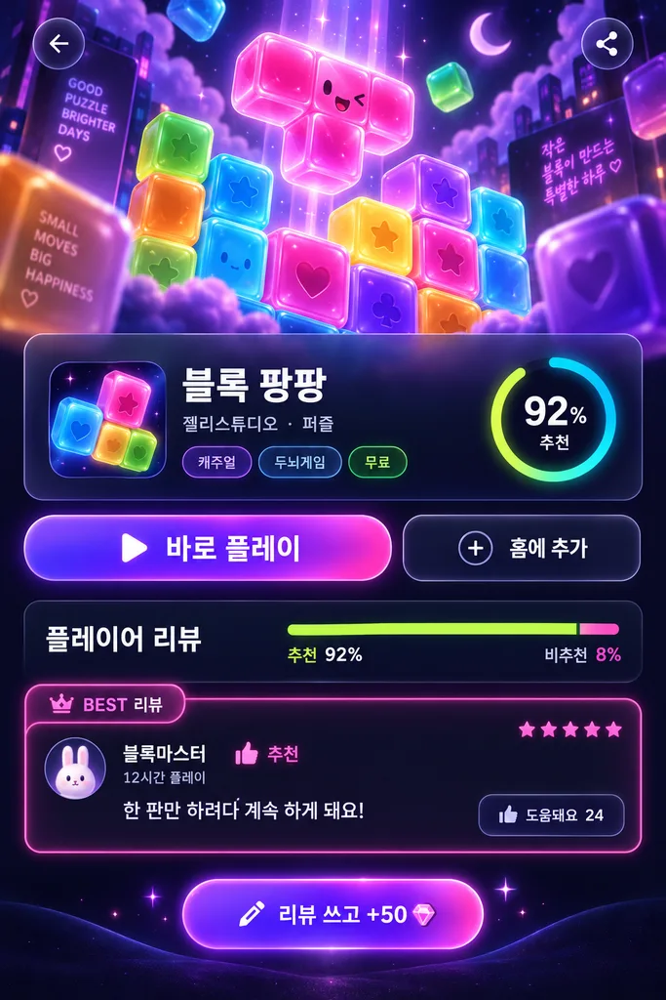
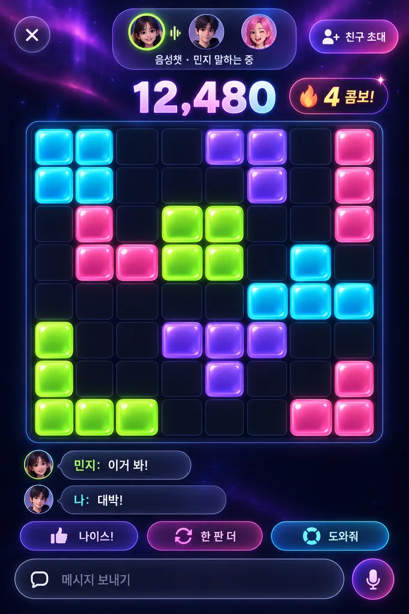
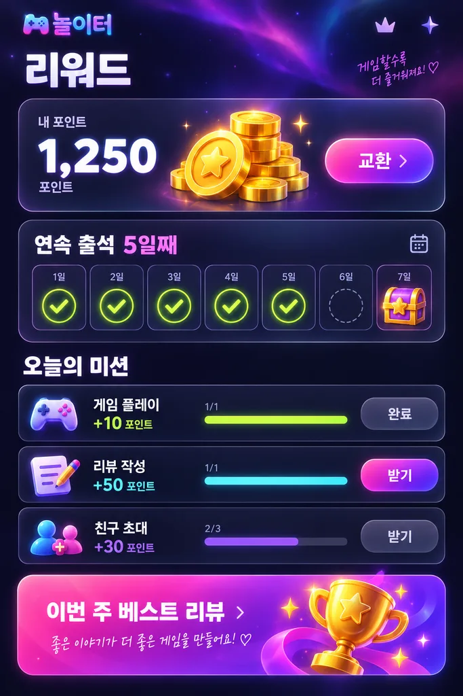

# 놀이터 2안 — "네온 나이트" (연습용)

[1안(캔디 아케이드)](https://github.com/fff1045-git/nolliteo)과 **내용·기능은 같고 디자인만 다른** 두 번째 시안입니다.
화면 시안과 게임 이미지는 모두 GPT 이미지 도구(코덱스 짭 MCP)로 만들었습니다.

| 홈 | 상세 | 플레이 | 리워드 |
| --- | --- | --- | --- |
|  |  |  |  |

- 디자인: 짙은 남색 + 오로라 빛, 유리 카드, 네온 테두리·글로우, 보라→핑크 그라데이션 버튼, 3D 젤리 아이콘
- 게임: **블록 팡팡**(8×8 블록 퍼즐), **2048 머지** — 1안과 같은 규칙, 네온 색으로만 바뀜
- 화면: 홈 · 게임 상세 · 플레이(풀스크린 + 채팅/음성챗 흉내) · 리뷰 쓰기 · 리워드 · 내 게임
- 모바일 세로 화면 기본, 1024px 이상에서는 사이드바 + 넓은 레이아웃
- 저장은 이 기기의 `localStorage`(`nolliteo-neon.v1`) — 1안과 포인트가 섞이지 않게 키를 따로 씀
- 포인트는 출석·플레이 시간·리뷰·친구 초대에만 지급 (게임 점수·승패와 무관)

로컬 확인: `python -m http.server 5175` 후 http://localhost:5175
